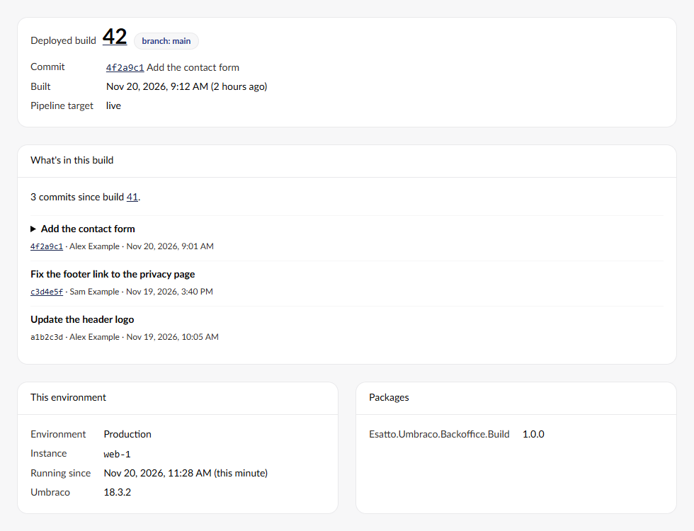
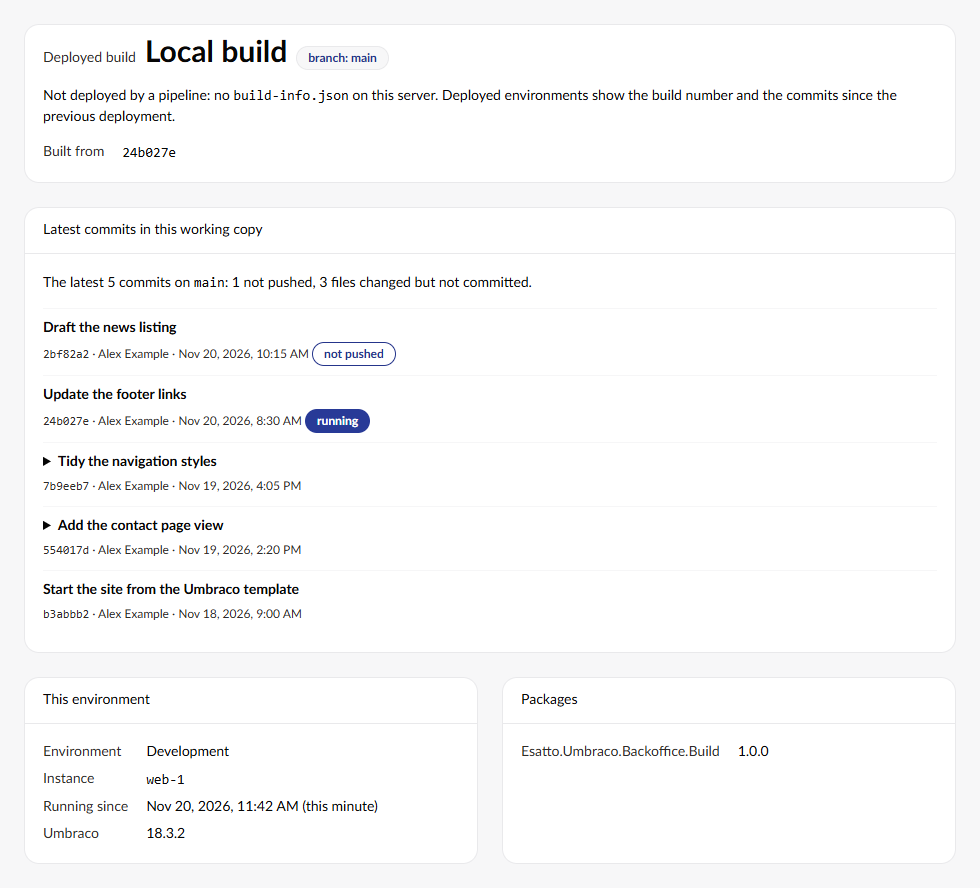
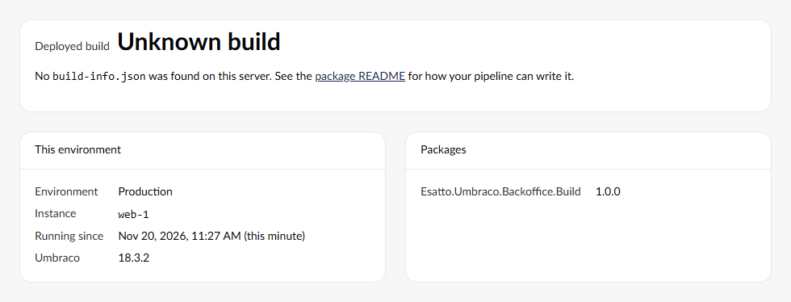

# Esatto.Umbraco.Backoffice.Build

Build for Umbraco 18: a dashboard under **Content > Build** that tells editors and developers which build is deployed on this environment and what changed in it.



## What it does

- **Shows which build is running.** Build number, branch, the commit it was built from (with its subject), build time and pipeline target, for example `live`. An editor or developer can see that the right build is on Test and on Live without asking anyone.
- **Lists what changed.** The commits this build adds since the previous deployment, with author, date and the commit message. The body of a message is collapsed under its subject, and `Co-Authored-By`-style trailers are stripped. Build numbers and commits link to your CI system and your Git host when the stamp carries URLs.
- **Shows this environment.** The environment name, the instance (the server's machine name), when the site started, and the Umbraco version.
- **Shows the versions of the packages that decide how the site behaves.** By default Umbraco Deploy, uSync, BlockPreview and every `Esatto.Umbraco.Backoffice.*` package; you can add more (see [Configuration](#configuration)).
- **Works in light, dark and high-contrast themes**, and never takes the backoffice down: a missing or broken stamp just shows an explanation.

The dashboard knows the build only because your CI pipeline writes a small stamp file, `build-info.json`, into the artifact it deploys (see [The build stamp](#the-build-stamp-build-infojson)). Without it, the first box has one of two other states:

**No stamp, but running in the Development environment inside a git repository.** The tab reads the local git log (it runs `git`, so git must be installed) and shows the latest commits of your working copy, tagged **running** (the commit this app was built from) and **not pushed**, with a count of uncommitted files. This happens only in Development and only when there is no stamp.



**No stamp anywhere else.** The tab says "Unknown build" and that no `build-info.json` was found on this server, with a link to this README.



## Install

```bash
dotnet add package Esatto.Umbraco.Backoffice.Build
```

Restart the site. The dashboard appears in the **Content** section as **Build**, with no other wiring. Everyone with access to the Content section can see it.

- **Umbraco 18 only.**
- **English only.** The texts are English whatever language the backoffice user has chosen. Dates and times follow the browser's locale; the relative phrase ("10 days ago") is English.
- Until a pipeline writes `build-info.json`, deployed environments show the "Unknown build" state above.

## Quick start

1. Install the package (`dotnet add package Esatto.Umbraco.Backoffice.Build`) and restart the site.
2. Add the script step to your pipeline: [Writing the stamp in your pipeline](#writing-the-stamp-in-your-pipeline).
3. Open **Content > Build** after the next deployment.

## The build stamp (`build-info.json`)

A small JSON file, camelCase, that your pipeline writes **before the deploy artifact is zipped**. It has to be written by CI because the site cannot work out its own build: Umbraco Cloud builds the site from a zip that has no `.git` folder, and many other hosts deploy without any git history either.

```json
{
  "schemaVersion": 1,
  "buildNumber": "42",
  "commit": "0123456789abcdef0123456789abcdef01234567",
  "buildUrl": "https://ci.example.com/builds/42",
  "commitMessage": "Add the contact form",
  "commitUrl": "https://git.example.com/acme/site/commit/0123456789abcdef0123456789abcdef01234567",
  "branch": "main",
  "targetEnvironment": "live",
  "builtAtUtc": "2026-11-20T09:12:00Z",
  "changes": {
    "sinceCommit": "89abcdef0123456789abcdef0123456789abcdef",
    "sinceBuildNumber": "41",
    "sinceBuildUrl": "https://ci.example.com/builds/41",
    "truncated": false,
    "commits": [
      {
        "sha": "0123456789abcdef0123456789abcdef01234567",
        "subject": "Add the contact form",
        "body": null,
        "author": "A. Developer",
        "dateUtc": "2026-11-20T09:01:00Z",
        "url": "https://git.example.com/acme/site/commit/0123456789abcdef0123456789abcdef01234567"
      }
    ]
  }
}
```

- **Required:** `buildNumber` and `commit`, both as JSON **strings** (`"buildNumber": 42` with a number is rejected; write `"42"`). Everything else is optional and may be left out or `null`, with one exception: `changes.truncated` may be left out, but when it is there it must be `true` or `false`; `null` rejects the whole stamp.
- **Unknown fields are ignored**, so a pipeline can add its own. `schemaVersion` is optional; the script writes `1`.
- `changes.sinceCommit` is `null` when no previous deployment is known; `commits` is then simply the latest commits and `truncated` is `true`. With a `sinceCommit` but no `sinceBuildNumber`, the tab says "since commit 89abcde" instead of "since build 41".
- A commit entry needs a `sha` and a `subject`; entries without them are left out.
- Times are ISO 8601 in UTC. A file saved with a byte order mark (for example by Windows PowerShell) is read normally: both UTF-8 and UTF-16 byte order marks are recognised.
- A URL becomes a link only if it starts with `http:` or `https:`, and then always with `rel="noopener"`. Anything else is shown as plain text.
- A field of the wrong type makes the **whole stamp ignored**, not just that field: a number for `buildNumber` or `commit`, `"truncated": null`, `"changes": []`, `"builtAtUtc": 123` or text that is not a date, an object where a list is expected (only `schemaVersion` is lenient: `"1"` as text is accepted). The same goes for a stamp that is not valid JSON, one that lacks `buildNumber` or `commit`, and one that cannot be read.
- A stamp that is **missing** is silently treated as "no pipeline build", and nothing is logged. A file that is **present but rejected** for one of the reasons above is treated the same way: the tab shows the same "No build-info.json was found on this server" text as for a missing file (in Development inside a git repository, the local build instead), and the log holds exactly one warning, written the first time the tab is opened after the site starts, that names the file and the reason. **If the tab says it found no stamp and you know the file is there, check the log first.** If the log has no such warning, the file is not where the site looks: see [Where the file must sit](#where-the-file-must-sit).

### Where the file must sit

The site reads `build-info.json` from its **content root**.

- **Umbraco Cloud:** in the project folder of the artifact that Cloud builds, next to `Program.cs`. Write it before the artifact is zipped.
- **Anywhere else:** in the folder the site runs from, which is the publish folder (the output of `dotnet publish`).
- **Somewhere else entirely:** set `Esatto:Build:FilePath`, see [Configuration](#configuration).

## Writing the stamp in your pipeline

The reference script is [`write-build-info.mjs`](https://github.com/carl-schele-esatto/Esatto.Packages/blob/main/Esatto.Umbraco.Backoffice.Build/pipeline/write-build-info.mjs). **It lives in the repository, not in the NuGet package**: download the raw file or copy it into your pipeline repository (for example as `build/write-build-info.mjs`) and run it as a pipeline step. It recognises Azure DevOps and GitHub Actions; on any other CI you set a few `BUILD_INFO_*` variables yourself.

```bash
node build/write-build-info.mjs --out MySite/build-info.json   # the project folder for Umbraco Cloud, the publish folder elsewhere
```

- Needs **Node 20 or newer** and **git** on the path. No npm packages.
- Needs a **checkout with the full git history**: `fetchDepth: 0` on Azure DevOps, `fetch-depth: 0` on GitHub Actions. GitHub's checkout fetches a single commit by default, and so may a new Azure DevOps pipeline, which cuts the list of commits short. The script still writes a valid stamp from a shallow checkout and says in the log what to change.
- Run it after the checkout, **before** the artifact is zipped. `--out` defaults to `./build-info.json` in the working directory; missing folders are created.
- It exits with code 1 and a message on stderr when it cannot write a stamp: it is not run inside a git repository (or `git` is not installed), no build number is available, it gets an unexpected argument or `--out` without a path, `git log` fails, or the output path cannot be written. Failing to look up the previous deployment never fails the step; the script then lists the latest 20 commits instead.
- It lists at most 100 commits (never merge commits) and sets `truncated` when there are more.
- The tokens below are used only for calls to your CI's own API. They are never written to the stamp or the log.
- The script comes with tests in the repository: `node --test pipeline/write-build-info.test.mjs`, run from the package folder.

### Azure DevOps

```yaml
steps:
- checkout: self
  fetchDepth: 0                       # the full history; new pipelines may default to a depth of 1

- task: UseNode@1
  inputs:
    version: '24.x'                   # Node 20 or newer

# ... restore, build and publish your site here ...

- script: node build/write-build-info.mjs --out MySite/build-info.json   # the project folder for Umbraco Cloud, the publish folder elsewhere
  displayName: Write build-info.json  # before the artifact is zipped
  env:
    SYSTEM_ACCESSTOKEN: $(System.AccessToken)    # must be mapped in; it lets the script read earlier runs
    BUILD_INFO_TARGET: live                      # shown as "Pipeline target"
    # BUILD_INFO_DEPLOY_TASK: Deploy to hosting   # optional: must equal the display name of your real deploy task, or no run qualifies; see below
    # BUILD_INFO_SINCE_COMMIT: 89abcdef0123456789abcdef0123456789abcdef   # list commits since this one; skips the lookup
```

- `SYSTEM_ACCESSTOKEN` is not available to scripts unless you map it through `env:` as above ([Microsoft docs](https://learn.microsoft.com/en-us/azure/devops/pipelines/build/variables)). Without it the script cannot find the previous deployment and lists the latest 20 commits. If the lookup is refused, check that the pipeline's build service account may view builds.
- **"Since the previous deployment"** is the latest earlier completed run of the same pipeline on the same branch. Only the **latest 20 completed runs** of the branch are inspected, newest first; if none of them qualifies, the tab lists the latest 20 commits instead. With `BUILD_INFO_DEPLOY_TASK` set, a run counts once the task with that **display name** succeeded, even if a later step failed (useful when a final "wait for the site" step can time out). Without it, a run counts when its result is `succeeded`. A run or task that finishes with warnings (`partiallySucceeded` or `succeededWithIssues`) does not count as a successful deployment.
- `BUILD_INFO_DEPLOY_TASK` is optional, and it must be the display name of your **real** deploy task, spelled exactly as in the pipeline (the comparison is exact and case-sensitive). If it names a task that none of the inspected runs completed successfully, no run qualifies and the commit list is the latest 20 commits; the log of the step then says so ("None of the last N completed runs … had a succeeded task named …"). That is why the snippet above leaves it commented out.
- An `env:` value that refers to a variable Azure does not define arrives as the literal text `$(Name)` and is stamped as it is, so check the spelling of pipeline variables you map into `BUILD_INFO_TARGET`.
- `BUILD_SOURCEBRANCHNAME` holds only the last path segment of the branch (`refs/heads/feature/x` gives `x`). Set `BUILD_INFO_BRANCH` if you want something else.
- For a repository hosted on GitHub, Azure's `BUILD_REPOSITORY_URI` may end in `.git`, which breaks the commit links. Set `BUILD_INFO_COMMIT_URL_TEMPLATE` (see below) to fix them.

### GitHub Actions

```yaml
on:
  push:
    branches: [main]

permissions:
  contents: read      # for actions/checkout
  actions: read       # lets the script read earlier workflow runs

jobs:
  deploy:
    runs-on: ubuntu-latest
    steps:
      - uses: actions/checkout@v7
        with:
          fetch-depth: 0                       # the full history; the default is 1 commit

      - uses: actions/setup-node@v7
        with:
          node-version: 24                     # Node 20 or newer

      # ... restore, build and publish your site here ...

      - name: Write build-info.json            # before the artifact is zipped
        run: node build/write-build-info.mjs --out MySite/build-info.json   # the project folder for Umbraco Cloud, the publish folder elsewhere
        env:
          GITHUB_TOKEN: ${{ secrets.GITHUB_TOKEN }}   # must be mapped in; it lets the script read earlier runs
          BUILD_INFO_TARGET: live                      # shown as "Pipeline target"
          # BUILD_INFO_SINCE_COMMIT: 89abcdef0123456789abcdef0123456789abcdef   # list commits since this one; skips the lookup
```

- Once you list any permission, every permission you leave out is set to `none`, so the workflow needs `contents: read` as well as `actions: read` ([GitHub docs](https://docs.github.com/en/actions/writing-workflows/workflow-syntax-for-github-actions)).
- "Since the previous deployment" is the latest earlier run of the same workflow, on the same branch, that concluded `success`. A run therefore counts only if the whole workflow succeeded, including the steps after the stamp.
- **The GitHub Actions path is verified against fixtures and a fake HTTP client only, until its first real run.** The request follows GitHub's documented "List workflow runs for a workflow" endpoint, but it has not yet talked to the real API. If the commit list on your first deployment is not what you expect, the log of the step says why.

### Any other CI

Set `BUILD_INFO_BUILD_NUMBER` (required here) and as many of the others as you can, then run the script inside the git checkout:

```bash
BUILD_INFO_BUILD_NUMBER="$YOUR_CI_BUILD_NUMBER" \
BUILD_INFO_BUILD_URL="https://ci.example.com/builds/$YOUR_CI_BUILD_NUMBER" \
BUILD_INFO_COMMIT_URL_TEMPLATE="https://git.example.com/acme/site/commit/{sha}" \
BUILD_INFO_TARGET=live \
BUILD_INFO_SINCE_COMMIT="$LAST_DEPLOYED_COMMIT" \
node build/write-build-info.mjs --out MySite/build-info.json   # the project folder for Umbraco Cloud, the publish folder elsewhere
```

Without `BUILD_INFO_SINCE_COMMIT` there is no way to know the previous deployment here, so the tab lists the latest 20 commits.

### Variables the script reads

The `BUILD_INFO_*` variables work on every CI and win over what the CI provides, with one exception: `BUILD_INFO_DEPLOY_TASK` is read on Azure DevOps only and has no effect anywhere else.

| Variable | Meaning |
|---|---|
| `BUILD_INFO_BUILD_NUMBER` | The build number. Required when neither Azure DevOps nor GitHub Actions is detected. |
| `BUILD_INFO_BUILD_URL` | Link to the build. |
| `BUILD_INFO_COMMIT_URL_TEMPLATE` | Where commit links point; `{sha}` is replaced by the commit id. |
| `BUILD_INFO_BRANCH` | The branch. Otherwise the CI's own value, otherwise `git branch --show-current`. |
| `BUILD_INFO_TARGET` | The pipeline target, for example `test` or `live`. Written as `null` when unset, and the tab then shows no pipeline target. |
| `BUILD_INFO_SINCE_COMMIT` | List the commits since this commit id (7 to 64 hexadecimal digits) instead of looking up the previous deployment. No API call is made. |
| `BUILD_INFO_DEPLOY_TASK` | The display name of the task that means "deployed"; see [Azure DevOps](#azure-devops). Optional. |
| `SYSTEM_ACCESSTOKEN` / `GITHUB_TOKEN` | Azure DevOps / GitHub Actions: the pipeline's token, which you must map into the step. |

Otherwise the script fills in the stamp from what each CI provides:

| Field | Azure DevOps | GitHub Actions |
|---|---|---|
| `buildNumber` | `BUILD_BUILDNUMBER` | `GITHUB_RUN_NUMBER` |
| `buildUrl` | the project's `_build/results?buildId=` page | the run's page under `GITHUB_SERVER_URL/GITHUB_REPOSITORY/actions/runs/` |
| `commit` | `git rev-parse HEAD` | `git rev-parse HEAD` |
| `commitUrl` | `BUILD_REPOSITORY_URI` (credentials removed) + `/commit/<sha>` | `GITHUB_SERVER_URL/GITHUB_REPOSITORY/commit/<sha>` |
| `branch` | `BUILD_SOURCEBRANCHNAME` | `GITHUB_REF_NAME` |
| `builtAtUtc` | the time the script runs | the time the script runs |

## Configuration

Both settings are optional, under `Esatto:Build` in `appsettings.json` (or any other configuration source):

```json
{
  "Esatto": {
    "Build": {
      "FilePath": "build-info.json",
      "Packages": [ "Contoso.Umbraco.*", "Some.Other.Package" ]
    }
  }
}
```

| Key | Default | What it does |
|---|---|---|
| `Esatto:Build:FilePath` | `build-info.json` | Where to read the stamp from, relative to the content root. An absolute path also works. |
| `Esatto:Build:Packages` | empty | Assembly names to list under **Packages**, **in addition to** the built-in list. A trailing `*` matches a whole family, for example `Contoso.Umbraco.*`. Only assemblies that are loaded are listed, each once; blank entries are ignored. |

The built-in packages list is Umbraco Deploy, uSync and BlockPreview (shown under those names) and every loaded `Esatto.Umbraco.Backoffice.*` assembly. Entries you add are shown under their assembly name, with the version the assembly carries.

Matching is **exact and case-sensitive**: an entry must equal the assembly name, and the text before a trailing `*` must be the start of it, letter for letter (spaces around an entry are ignored). The assembly name is usually the NuGet package ID, but it is the name of the assembly that counts (normally its `.dll` file name without the extension), so check that if a package does not appear.

## Who can see what

The dashboard and its API (`GET /umbraco/management/api/v1/esatto/build-info`) are open to everyone with access to the **Content** section, and are read-only: nothing can be changed or triggered from them, nothing is stored, and no data leaves your server. What those users can read is whatever the stamp contains: commit subjects and bodies, author names, build and commit URLs, the branch and the target, plus the server's machine name, the environment name and the package versions; in Development without a stamp, also your local git history. The API response also carries `appVersion`, the host assembly's informational version, which usually contains the commit it was built from (its sha). **Never put secrets in commit messages**, and stamp only what you are happy for your editors to see.

## What it does not do

- **It does not write the stamp for you from MSBuild or a dotnet tool.** Your pipeline runs the script (Azure DevOps and GitHub Actions are detected; other CI systems use the `BUILD_INFO_*` variables).
- **It does not check the stamp.** It shows what the pipeline recorded, so a stamp written for another artifact will be shown as it is.
- **It does not compare environments** (Test against Live), keep release notes, roll back, or trigger deployments.
- **It cannot hide commit bodies or authors.** Leave them out of the stamp instead (they are optional).
- **It has no settings screen.** Configuration is `appsettings` only.
- **It has no other language than English.** Other backoffice languages fall back to the English texts.
- **It is not an environment indicator.** Umbraco Cloud already shows the environment in the backoffice header; this package is about the build and the commit.

## Source

[github.com/carl-schele-esatto/Esatto.Packages](https://github.com/carl-schele-esatto/Esatto.Packages/tree/main/Esatto.Umbraco.Backoffice.Build). MIT licence.
